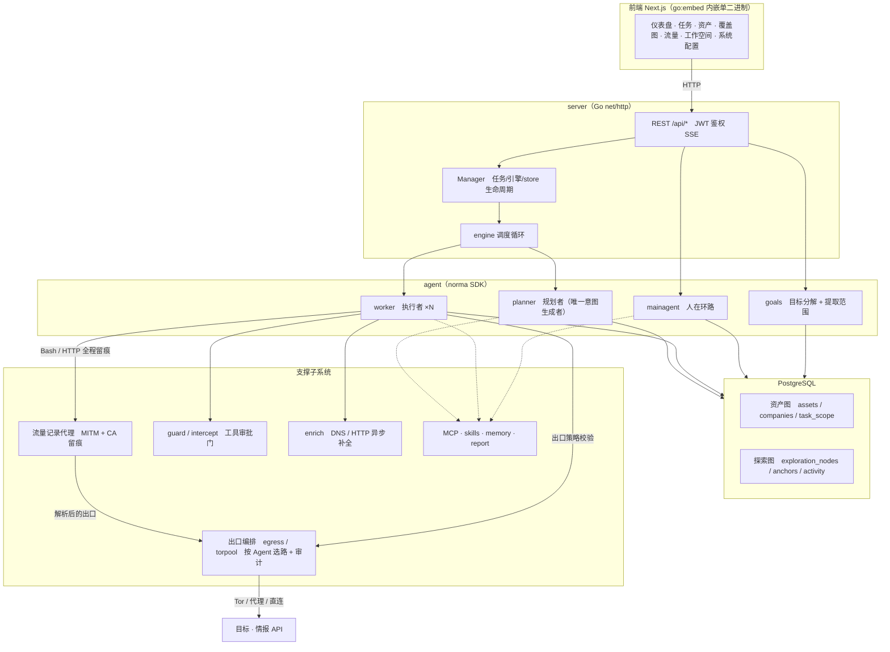
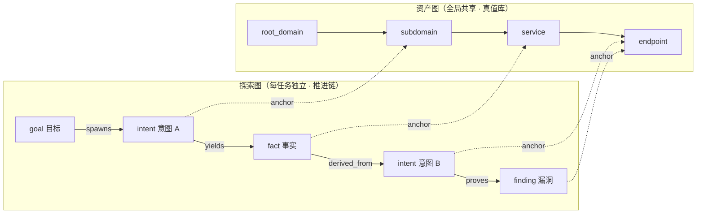
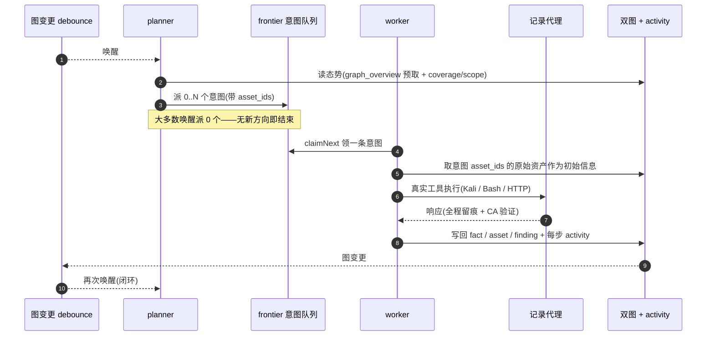
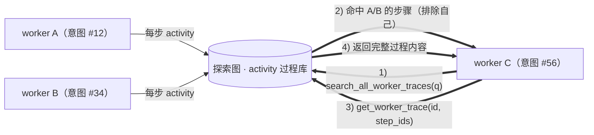
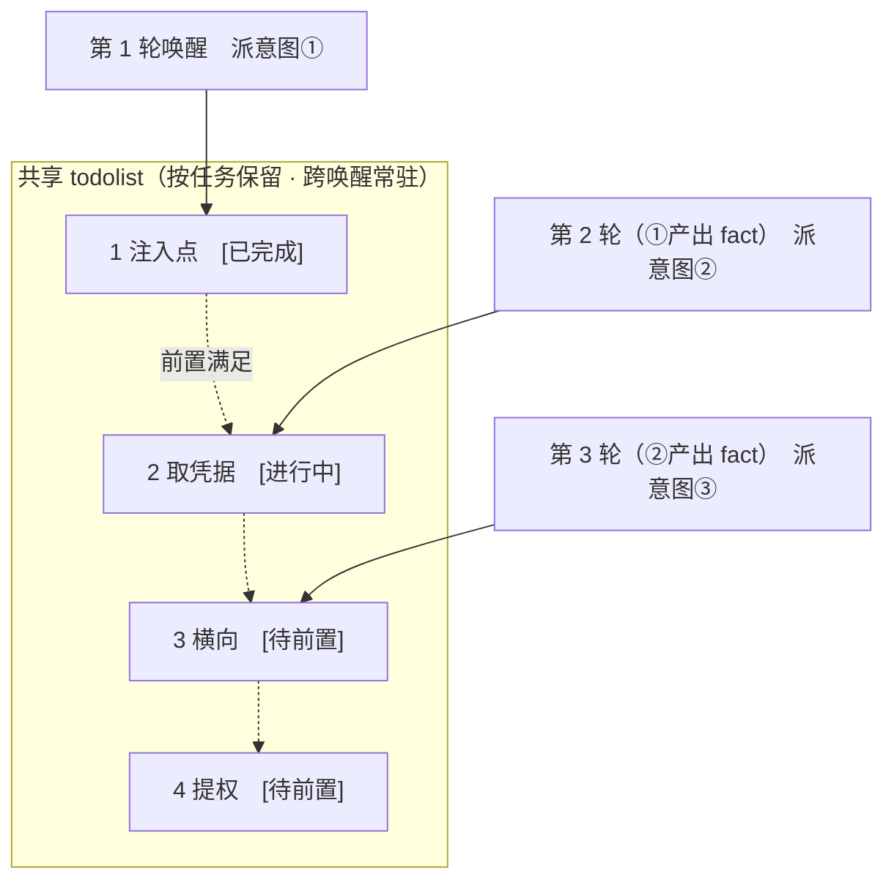

<div align="center">

# ARTEX

AI 自主渗透测试系统（Go 后端 + Next.js 前端）


🌐 **在线 Demo（模拟数据）**： [https://artex-demo.mhtsec.com](https://artex-demo.mhtsec.com)

📦 **该仓库为ARTEX最后一个版本纯源码备份。原 Docker 镜像源 `autumn27/artex` 已失效，现由本仓库自维护镜像 `mianhuatang11/artex`（Docker Hub）；拉取失败时可 `docker compose build` 从纯源码本地构建，无任何外部预编译依赖。**

🕵️ **目标流量默认经 Tor 出行**：per-Agent 独立 Tor 实例池 + 出口审计 + Onion 入站，策略按「流量类别」在工具执行层强制（详见 [网络出口与隐蔽通道（Tor）](#网络出口与隐蔽通道tor)）。

</div>

---

## 截图预览

> 完整交互见[在线 Demo](https://artex-demo.mhtsec.com)（纯前端 + Mock 数据，无需后端）。

| 仪表盘（总览 / Token 消耗 / 活动流） | 任务列表 |
| :---: | :---: |
|  |  |

| 任务 · 执行过程（会话 / 工具调用） | 探索链路 |
| :---: | :---: |
|  |  |

| 发现 | 资产 |
| :---: | :---: |
|  |  |

| 资产覆盖图（力导向布局 · 已测高亮 · 节点折叠展开） |
| :---: |
|  |

| 流量录制 | 人在环路对话 |
| :---: | :---: |
|  |  |

| Agent 管理 | LLM 配置 |
| :---: | :---: |
|  |  |

| 拦截审批 | 后端日志 |
| :---: | :---: |
|  |  |


---

## 审批记录详情

全局「审批记录」、任务内「拦截审批」及对话中的审批卡片均支持展开查看详情。展示结构参考
[AegisHook 的审批详情组件](https://github.com/RuoJi6/AegisHook/blob/main/web/src/components/CallDetail.vue)，沿用 ARTEX 的组件和主题：


## 资产同步（ScopeSentry）

支持从 [ScopeSentry](https://github.com/Autumn-27/ScopeSentry) 直接同步资产数据，免去重复收集：

- 在「**资产同步**」页填 ScopeSentry 的地址与 API Key，接入数据源；
- 按**项目**或**任务**维度选择要同步的目标与资产类型（域名 / 子域 / IP / 端口 / 站点 / 端点…）；
- 一键导入并按公司资产范围归并，直接进入 ARTEX 的资产图供 agent 探索使用。

---

## 安装

> 依赖数据库 **PostgreSQL**；探索需配置 **LLM**（`ANTHROPIC_API_KEY` 或 `OPENAI_API_KEY`，也可在 UI 里配）。

### 方式一：一键安装脚本（推荐）

```bash
git clone https://github.com/mhtsec/ARTEX.git
cd ARTEX
./install.sh
```

脚本会：检测 / 自动安装 Docker → 让你选 **① 全部 Docker** 或 **② 本地编译运行**：

- **① 全部 Docker**：填一个 Postgres 密码（可回车随机）→ 自动写 `.env` → `docker compose up -d`。
- **② 本地运行**：选数据库（连已有 / 用 Docker 起一个）→ 生成 `config.json` → `go` 编译内嵌单二进制 → 启动。

装好后打开 **http://localhost:8787**（首次进入 `/setup` 设置管理员密码）。

### 方式二：Docker Compose（手动）

```bash
git clone https://github.com/mhtsec/ARTEX.git
cd ARTEX
cp .env.example .env          # 填 POSTGRES_PASSWORD、可选 ANTHROPIC_API_KEY
docker compose up -d          # 拉取 mianhuatang11/artex 镜像 + postgres
# → http://localhost:8787
```

> 原镜像源 `autumn27/artex` 已从 Docker Hub 删除，镜像现由本仓库自维护为 **`mianhuatang11/artex`**。
> 镜像源不可用（或想自行改代码）时，本地从纯源码构建即可：`docker compose build && docker compose up -d`。
> Dockerfile 为多阶段构建（前端静态导出 → Go 静态编译 → 运行镜像），默认走国内友好依赖源，可加 `--build-arg GOPROXY=... / --build-arg NPM_REGISTRY=...` 覆盖。

镜像已含常用工具（ripgrep/curl/vim/npm/nmap…）；`./skills` 与 `./data` 以绑定挂载持久化。

远程 MCP 可在系统设置中选择 `http`（Streamable HTTP）或 `sse`（旧版 SSE）。
旧版 SSE 服务通常使用 `GET /sse` 建立事件流，再通过服务返回的
`/message?sessionId=...` 接收 JSON-RPC 请求；配置时将 URL 填为 `/sse`，请求头按
`Authorization=Bearer <token>` 填写。

### 方式三：下载预编译二进制（Releases）

到原仓库 [Releases](https://github.com/Autumn-27/ARTEX/releases) 下载对应平台的 zip（**本备份仓库不托管二进制**，若原 Releases 也失效请用方式二或方式四）：解压后得到 `artex` + `start.sh`（Windows 为 `start.bat`）+ `skills/` + `config.example.json`：

```bash
cp config.example.json config.json   # 填好 database 连接
./start.sh                           # → http://localhost:8787
```

> 请用 `start.sh` / `start.bat` 启动，而不是直接跑 `./artex`。它是个守护脚本：程序退出后按退出码决定是否重新拉起，**页面上的[一键更新](#方式一页面一键更新推荐)靠它完成换装**。直接运行 `./artex` 时更新完就不会被拉起了。
> 后台常驻：`nohup ./start.sh >artex.log 2>&1 &`。

### 方式四：从源码编译单二进制

```bash
# 1) 前端静态导出
cd web && npm ci && npm run build:static && cd ..
# 2) 拷进内嵌目录
cp -r web/out server/webui/dist
# 3) 编译（-tags embedui 才内嵌前端）
CGO_ENABLED=0 go build -tags embedui -o artex ./cmd/artex
./start.sh
```

### 方式五：构建跨平台 Release 压缩包

`build.sh` 会先构建并嵌入前端，再使用 Go linker 去除调试信息，并将发布文件压缩为 zip。Release 模式默认生成 Linux amd64/arm64、macOS amd64/arm64 和 Windows amd64 的 zip 包：

```bash
./build.sh --release
# 产物：dist/artex-0.3.3-*.zip
```

UPX 自解压二进制可能与部分 Linux 内核、虚拟化环境或安全策略不兼容，因此默认不启用。可用 `ARTEX_TARGETS` 自定义目标；确认目标运行环境兼容时，可显式传入 `--upx` 进一步缩小二进制：

```bash
ARTEX_TARGETS=linux/amd64,windows/amd64 ./build.sh --release
./build.sh --target linux/amd64 --upx
```

---

## 更新升级

> 升级只换程序、不动数据：Postgres 数据卷 `pgdata`、`./data`（jwt.key / SQLite 等）、`./skills` 都会保留。**数据库迁移无需手动执行**——`artex` 每次启动会幂等重跑 `schema.sql`（含 `ADD COLUMN` / `CREATE INDEX IF NOT EXISTS`），即“重启即迁移”。升级前仍建议先备份 `./data` 与数据库。

### 方式一：页面一键更新（推荐）

在 **系统配置** 页（侧边栏「系统配置」→ `/system/settings`）的**版本与更新**卡片里，可以直接检查并安装新版本，无需登录服务器。

点「更新」后：下载当前平台的发布包 → 比对 Release 的 `SHA256SUMS` → 用 `-h` 冒烟测试新二进制 → 暂存为 `artex.new` → 程序退出，由 `start.sh` / `start.bat` 重新拉起并完成换装。页面会自动等到新版本上线后刷新。

- **失败不会留下坏程序**：校验或冒烟不通过就丢弃暂存件、继续跑当前版本；换装后的新版若连续 3 次启动失败，会自动回滚到 `artex.old`（失败的那个留作 `artex.failed` 供排查）。
- **随时可回退**：上一版本保留为 `artex.old`，卡片上有「回滚到上一版本」。注意数据库结构不会回退。
- **更新会中断正在运行的任务**——更新即重启，请在空闲时进行。
- **开发构建不给更新**：版本号是 `dev` 或 `git describe` 带后缀时禁用，避免正式版覆盖掉本地调试的二进制。
- **Docker 下只换程序、不换镜像**：镜像里的 playwright / nmap 等工具链不会跟着升级，且 `docker compose up -d` 重建容器后会退回镜像自带的版本。要连镜像一起升级仍请用 `docker compose pull artex && docker compose up -d artex`。
- 访问 GitHub 需要代理时，在同一页面配置**全局代理**即可，更新链路会走它。更新只从 GitHub 域名下载并强制 HTTPS。

### 方式二：一键更新脚本

```bash
cd ARTEX
./update.sh
```

脚本先可选 `git pull` 拉取最新代码，再让你选 **① Docker 更新** 或 **② 本地编译更新**（与 `install.sh` 对应）：

- **① Docker**：可指定目标镜像 tag（回车沿用 `.env` 的 `ARTEX_TAG`，缺省 `latest`）→ `docker compose pull` → `docker compose up -d`（换新镜像重启即自动迁移）。
- **② 本地**：重建前端静态产物 → 重新编译 `./artex`（完成后重启进程生效）。

### 方式三：Docker Compose（手动）

```bash
cd ARTEX
git pull                       # 更新 compose / 脚本（可选）
# 指定版本：在 .env 设 ARTEX_TAG=v0.2.0；不设则用 latest
docker compose pull artex
docker compose up -d artex     # 换新镜像重启 → 自动迁移 schema
docker image prune -f          # 清理旧镜像（可选）
```

### 方式四：预编译二进制（Releases）

到 [Releases](https://github.com/Autumn-27/ARTEX/releases) 下载新版本 zip，停掉旧进程后覆盖 `artex` 与 `skills/`（保留你的 `config.json` 与 `data/`），重启即可：

```bash
cp -r <解压目录>/skills ./ && cp <解压目录>/artex ./
./start.sh
```

### 方式五：从源码编译

```bash
git pull
cd web && npm ci && npm run build:static && cd ..
cp -r web/out server/webui/dist
CGO_ENABLED=0 go build -tags embedui -o artex ./cmd/artex
# 重启 ./start.sh
```

---

## 配置

**数据库**（`config.json`，或用环境变量 `ARTEX_PG_DSN` 覆盖）：

```json
{
  "database": {
    "host": "127.0.0.1", "port": 5432,
    "user": "artex", "password": "yourpass",
    "dbname": "artex", "sslmode": "disable"
  }
}
```

**LLM**：`export ANTHROPIC_API_KEY=sk-...`（或 `OPENAI_API_KEY`），也可在 UI 的「LLM 配置」页填写。
可选：`ARTEX_LLM_PROVIDER` / `ARTEX_LLM_MODEL` / `ARTEX_LLM_BASE_URL` / `ARTEX_LLM_PROXY`。

**并发**：每个任务的 work agent 数在「系统设置」里配置（默认 3）。

**常用参数**：`./start.sh -addr :8787 -proxy :8788`（`-addr` 前端+API，`-proxy` 流量录制代理）。启动脚本会把参数原样透传给 `artex`。

### 反向代理部署（HTTPS / 只开放 443）

前端和 API/SSE 都由同一个后端端口（默认 `:8787`）提供，实时活动流默认走**同源**地址，因此**无需配置 `NEXT_PUBLIC_SSE_BASE`**，公网只开放 443、把 8787 留在内网即可。

SSE 是长连接 + 持续推送，反代**必须关闭缓冲**，否则浏览器能连上却收不到事件（表现为活动流一直转圈）。Nginx 示例：

```nginx
server {
    listen 443 ssl;
    server_name your.domain.com;
    # ssl_certificate / ssl_certificate_key ...

    location / {
        proxy_pass http://127.0.0.1:8787;
        proxy_set_header Host $host;
        proxy_set_header X-Forwarded-Proto $scheme;

        # SSE 关键项：关缓冲、长超时、HTTP/1.1
        proxy_buffering off;
        proxy_cache off;
        proxy_read_timeout 3600s;
        proxy_http_version 1.1;
        proxy_set_header Connection "";
    }
}
```

> 仅当 SSE 需要走与页面不同的来源（如独立子域）时，才在**构建期**设置 `NEXT_PUBLIC_SSE_BASE`（该变量在 `next build` 时固化进静态包，容器运行时再设无效）。

---

## 网络出口与隐蔽通道（Tor）

目标流量**默认匿名**，而且这条策略由代码在「工具执行层」强制，不依赖提示词——模型可以无视提示词，`checkToolEgress` 不会。

> 前置：需要 `tor` 可执行文件（`brew install tor` / `apt install tor`），或用 `tor_binary` 指向自带二进制。

### 出站策略矩阵（按流量类别，不按 Agent）

类别声明在工具上（`tools.egress_class`），因此一个配置宽松的扫描器也不会继承「直连」默认值：

| 类别 | 典型流量 | 默认出口 | 可放开 |
| --- | --- | --- | --- |
| `target-probe` | 子域枚举、指纹识别、目录/端口探测、爬虫 | **Tor（强制匿名）** | ❌ 系统无可用匿名出口时**拒绝执行**（fail-closed） |
| `target-exploit` | 漏洞利用、后渗透请求 | **Tor** | ✅ 任务级显式豁免，并写入审计 |
| `intel-query` | FOFA / Shodan / Quake 等第三方情报 API | 真实 IP | ✅ 默认允许（这些平台封禁 Tor 出口）；白名单 `fofa.info`、`api.shodan.io`、`quake.360.cn` |
| `platform-self` | 升级、工具下载、镜像拉取 | 直连 / 系统代理 | — |
| `notify` | 告警、webhook 投递 | 直连 / 系统代理 | — |

工具还可声明 `needs_udp`：命中且出口是 Tor 时**直接拒绝**（Tor 不承载 UDP），不会因「反正也是匿名」而勉强放行。被拒时的报错是显式的：

```
出口策略拒绝执行(target-probe, agent=worker): 无可用匿名出口；不会回退直连
```

相关设置：`egress_strict`（fail-closed 总闸）、`global_proxy`（全局出口代理）、`tor_socks_addr` / `tor_control_addr` / `tor_cookie_path` / `tor_binary`（单 daemon 模式）。

### 多 Tor 实例：per-Agent 独立出口

单个 daemon 的问题不是匿名性，而是**换电路是进程级**的：一个 Agent 想换 IP，会把所有 Agent 的电路一起换掉。实例池让每个 Agent 落在自己的 daemon 上。

- 「系统设置」页的「Tor 出口」（单 daemon + `严格模式（fail-closed）`）与「Tor 实例池（每 Agent 独立出口）」两个区块，对应设置项：`tor_pool_enabled`、`tor_pool_size`（1–32，默认 5）、`tor_pool_socks_base`、`tor_pool_control_base`、`tor_pool_dir`、`tor_pool_upstream`。
- slot N 的端口 = `base + N - 1`；Agent 通过**稳定哈希**固定到某个 slot（`agents.egress_tor_instance`，1-based；`0` = 回落到单 daemon）。
- 启动**全有或全无**：任一 slot 起不来就整池失败，不留「一半在 Tor 上」的状态。
- 就绪判定用控制口 `GETINFO status/bootstrap-phase` 要求 `PROGRESS=100`——**TCP 能连 ≠ 已可用**，这是实测踩出来的。
- 重启后通过 `GETINFO config-file` 认领自己上一轮遗留的 daemon（cookie 不能先删，它就是认领凭证），端口冲突不再把启动打挂。
- `tor_pool_upstream` 可给 daemon 自身挂上游 HTTP 代理（`host:port`），用于出口网络本身被封的环境。

| 控制面接口 | 说明 |
| --- | --- |
| `GET /api/system/torpool` | 池状态（各 slot 端口 / bootstrap 进度 / 健康字段） |
| `POST /api/system/torpool/start` · `/stop` | 起停整池 |
| `PUT /api/system/torpool` | 保存池配置 |

### Agent 级出口配置与审计

「Agent 管理 → 出口」页签：出口策略（`direct` / `proxy` / `tor`）、Tor 出口国家偏好、固定实例、**出口实测**（拉最近几次 run 直接显示 `is_tor` 真/假）、**换电路**按钮（UI 明确提示：共享 daemon 时换电路是全局的）。严格模式（`egress_strict`）在这里是只读告警：开启且当前没有可用匿名出口时，页签内会直接提示所有触达目标的工具都将被拒绝。

每次 run 的解析结果落在 `agent_egress_runs`：

| 字段 | 含义 |
| --- | --- |
| `mode` / `proxy` | 实际出口；代理凭据在审计里按 `***@` 脱敏 |
| `is_tor` | 是否 Tor 出口 |
| `tor_instance` | 命中的池 slot；`0` = 共享 daemon |
| `circuit` | 电路隔离键（SOCKS 用户名，只影响 circuit，不是口令） |

> runtime 里的 slot 名（如 `work#3`）在审计前会归一化成 `worker`，否则同一 Agent 会因 key 漂移出现「refused」假阳性。

### 全流量透明代理（容器内，可选）

上面的出口策略依赖代理环境变量 + 执行层拒绝，覆盖不到 `nmap`/`dig` 这类不读代理、或自己指定
解析器的工具。仓库内置一套容器级透明代理（`deploy/artex-entry.sh` + `deploy/tor-shim.sh`），
由 `Dockerfile.tor` 打进镜像，`docker-compose.override.yml` 授予 `NET_ADMIN`：

- `nat OUTPUT`：TCP 全量 `REDIRECT` 到 tor `TransPort(9040)`；`udp/tcp 53` 重定向到 `DNSPort(19053)`；
- `filter OUTPUT`：其余 UDP/ICMP 直接丢弃（Tor 不承载 UDP，宁可失败也不真实出网）；
- tor 以独立用户 `artestor` 运行，iptables 用 `-m owner --uid-owner` 放行 tor 自身流量，避免自套成环；
- 放行 loopback / 容器内网 / 已建立连接，`8787`、`8788` 的对外服务与 PostgreSQL 不受影响。

取舍：透明转发的流量统一走 slot 1 的出口（SOCKS 的 per-Agent 分槽仍可用）；UDP 工具（含 QUIC/HTTP3）
会失败而不是泄漏；`ARTEX_TRANSPARENT_TOR=0` 可临时关闭排障。tor `DNSPort` 只实现了 A/AAAA/PTR，
`TXT/MX/NS/SRV` 查询会返回 `NOTIMP`。

### 「配了 Tor 却还是真实 IP」——已修的四个坑

都是实测中被外部观测点的日志抓出来的，不是推测：

1. **`getenv` 取第一个匹配**：旧实现用 `append(os.Environ(), extra...)` 注入代理，环境里已有同名变量时新值永远不生效 → 改为覆盖语义（`norma/tool` 的 `withEnv`）。
2. **宿主 `~/.curlrc` 压过所有环境变量**：rc 文件里的 `proxy = http://...` 会让 `HTTP_PROXY` 全部失效 → 每次出口生成**独立的** `CURL_HOME/.curlrc` 与 `WGETRC/.wgetrc`；直连出口写 `noproxy = "*"`，避免 rc 把「直连」偷偷改成走代理。
3. **`socks5://` 会本地解析域名**：既把目标域名泄漏给本地 DNS，也让 `.onion` 根本解析不了 → 统一改写为 `socks5h://`（远程 DNS）。
4. **proxychains 类包装器**：PATH 里的 `proxy-guard-run.sh` 一类 shim 由包装器自己决定代理，环境变量管不住 → 启动时扫描并告警（实测命中 42 个）。

### Onion 入站（反连 / 回调）

「系统 → 入站通道」管理 v3 隐藏服务：新建服务、查看 `.onion` 地址、按客户端授权（x25519 密钥对，可单独吊销）、启停。torrc 片段的关键是 `HiddenServiceVersion 3` 与 `HiddenServicePort <虚拟端口> <目标>`——旧实现只写端口，tor 会直接拒绝启动。

接口：`GET/POST /api/inbound/onion`、`POST /api/inbound/onion/{name}/clients`、`DELETE /api/inbound/onion/{name}/clients/{client}`、`POST /api/inbound/onion/{name}/enable`。

### 信标通道

「系统 → 信标通道」配合独立客户端 `cmd/beacon-client`：操作侧下发命令、被控侧拉取并回执、可撤销。消息体端到端加解密（`beacon/crypto.go`），平台只当中继。

接口：`/api/beacon/channels`（列表 / 创建 / 撤销）、`/api/beacon/channels/{channel}/commands`（入队 / 取件）、`/poll`、`/pull`、`/flush`。

### 验证方法（怎么证明「真的在走 Tor」）

```bash
# 1) 实例池单测 + 真实 Tor 端到端（需要本机 tor）
go test ./torpool/
go test -tags e2e ./torpool/ ./server/

# 2) 完整回归（41 项断言，需要后端已启动并准备好 JWT）
ARTEX_BASE=http://127.0.0.1:8899 ARTEX_TOKEN_FILE=/tmp/token.txt ./test/regression/tor_features.sh
```

用自己的可控观测点（自建回显服务、dnslog、httpworkbench 实例等）交叉验证时：

- **只信 HTTP 台账**：`type=http` 那批的源 IP 必须全部落在 [Tor 出口列表](https://check.torproject.org/torbulkexitlist) 内。
- `type=dns` 行的 `address` 是**解析器**而不是客户端：出口自己解析就是出口 IP；出口把递归转给 Cloudflare / Google 时就是那家递归器的地址。它无法反推你的真实 IP，同样也不能当作泄漏证据。
- 判定「有没有泄漏」的硬指标只有一条：本机出口 IP（对照 Clash / 系统代理的出口地址）**一次都不该出现**。

> 设计细节、缺陷复盘与测试计划见 [docs/TOR-AGENT-EGRESS-DESIGN.md](docs/TOR-AGENT-EGRESS-DESIGN.md)。

---

## 开发

### 手动漏洞复测

任务详情的「复测」页签可分页选择本任务的漏洞、查看历次结论和证据，并手动发起复测。启动后保留当前页签，显示转圈图标和「复测中」；确认修复后同步更新漏洞状态。

在漏洞列表每行操作区点击「复测」，或在漏洞详情的「漏洞复测」区域点击「发起复测」，填写可选的修复版本、测试条件或限制，系统会创建独立的复测 Agent 会话，启动后保留当前页面。列表的平铺、按任务分组和资产视图均支持该入口；复测运行时显示转圈图标和「复测中」，需要查看时点击进入对应会话，结束后恢复「复测」。复测无需重新启动原扫描任务，结论分为「仍可复现」「已修复」「无法确认」，每次的结论、证据和会话链接保存在漏洞详情中。

新版后端首次启动会预置可编辑的「漏洞复测」（`retester`）Agent，可在 Agent 管理中配置提示词、LLM、运行预算和工具。默认使用其绑定的 LLM，未绑定则使用全局激活配置。复测会话成功完成且结论为「已修复」时，系统自动将漏洞处置状态改为「已修复」；执行中、失败、停止或其他结论保留原状态。原始证据和报告始终保留。也可在状态下拉菜单中手动选择「已修复」。同一漏洞正在复测时复用已有会话，停止、失败或服务重启后可重新发起。

本版历史记录通过漏洞详情和会话查看，暂未纳入漏洞报告导出或任务归档包，也未自动关联流量包。演示模式只生成明确标注的模拟记录，不请求真实目标。

### 本地运行与测试

```bash
./dev.sh    # 后端(:8787) + 流量代理(:8788) + 前端 next dev(:5173) → http://localhost:5173
```

- 后端：`go run ./cmd/artex`（不带 `-tags embedui` 则不内嵌前端）
- 前端：`cd web && npm run dev`（`/api` 反代到后端，带热更新）
- 测试：`go test ./...`
- Tor 端到端（需要本机 `tor`）：`go test -tags e2e ./torpool/ ./server/`；完整回归见 [验证方法](#验证方法怎么证明真的在走-tor)
- Mock 预览（无后端）：`cd web && NEXT_PUBLIC_MOCK=1 npm run dev`
- 在线 Demo 重新部署（Cloudflare Pages，静态导出 + Mock 数据）：
  ```bash
  cd web && NEXT_PUBLIC_MOCK=1 npm run build:static
  CLOUDFLARE_API_TOKEN=<token> npx wrangler pages deploy out --project-name=artex-demo --branch=main
  ```

### 本地运行排障

**① `./start.sh` 提示「找不到可执行文件 ./artex」**

`artex` 是编译产物，本仓库不托管二进制（`.gitignore` 已忽略 `/artex`）。按上文「方式四：从源码编译单二进制」先编译一次：

```bash
cd web && npm ci && npm run build:static && cd ..
cp -r web/out server/webui/dist
CGO_ENABLED=0 go build -tags embedui -trimpath -o artex ./cmd/artex
./start.sh
```

**② 启动后终端不停刷「connection refused / 异常退出 → 重启」**

`start.sh` 是守护脚本：artex 退出后会按退出码反复拉起（退避 1→2→4…最多 60 秒），所以数据库连不上时终端会持续刷屏。此时先 `Ctrl-C`（或 `kill` 掉 `start.sh` 进程）停止，再排查：

- `config.json` 的 `database.port` / `password` 是否与本机 Postgres 实际监听一致（`docker ps` 查看端口映射；`docker-compose.yml` 里的 postgres 默认不对外发布端口，裸跑二进制时需要自行把 Postgres 端口映射到宿主）。
- 确认数据库可连后再 `./start.sh`。连接就绪前程序会因 `open stores: ping postgres ... connection refused` 一直退出重启。

---

## 系统技术架构

ARTEX 是一套 **LLM 多 agent 驱动的自主渗透系统**：Go 单体后端（内嵌 Next.js 前端）+ PostgreSQL，agent 能力由 [`norma`](https://github.com/Autumn-27/norma) SDK 提供（`agentcore` / `tool` / `permission` / `harness` / `memory` / `transcript`）。核心是**双图架构**，以及围绕它的两条自主性机制：**worker 间过程级信息交换**与 **planner 多轮共享 todolist 稳定攻击链路**。

### 总体分层



| 层 | 职责 |
| --- | --- |
| **前端** | Next.js 静态导出，`go:embed` 内嵌进单二进制；可视化任务/资产/探索链路/覆盖图，人在环路对话 |
| **server** | `net/http` 路由 + JWT 鉴权 + SSE；`Manager` 托管任务、引擎、DB store 的生命周期 |
| **engine** | 每任务一个 `plannerLoop` + N 个 worker goroutine；意图领取、超时/暂停/drain |
| **agent** | goals / planner / worker / mainagent，`ToolSet` 把双图暴露成 LLM 工具 |
| **db** | 双图的 Postgres 落地（pgx）；schema 随 `go:embed` 每次启动幂等建表 |
| **出口** | `egress` 按流量类别解析出口（Tor 池 / 全局代理 / 直连），`torpool` 管理多 daemon，结果落 `agent_egress_runs` 审计 |
| **支撑** | 记录型 MITM 代理、审批门、异步补全、MCP/技能/记忆/报告 |

### 双图架构：探索图 + 资产图

系统把「**目标是什么**」和「**测到了什么程度**」拆成两张相互独立、又通过锚点相连的图：

- **资产图（Asset Graph，全局共享）**：跨任务同一份的资产真值库。节点为 `root_domain / subdomain / ip / service / app / endpoint`，归属公司；域名→子域→服务→端点的父子关系与去重 key 全部由程序计算，agent 只提交原始信息。
- **探索图（Exploration Graph，每任务独立）**：一次任务的“思考与推进”过程。节点为 `goal（目标）/ intent（意图）/ fact（事实）/ finding（漏洞）/ hint（提示）`，靠 `spawns / derived_from / yields / proves` 等边连成**血缘链**，回答“哪个方向派生自哪些事实、产出了什么”。
- **两图靠锚点相连**：`exploration_anchors(node_id, asset_id)` 把意图/事实/漏洞锚定到具体资产上——于是既能从“探索方向”看它打的是哪些资产，也能从“某个资产”反查它在本任务被哪些意图测过、得出过哪些事实。这也支撑了**资产测试覆盖度**与**资产覆盖图**（范围内资产 + 已测高亮）。



> 分工：**planner** 读探索图态势、判目标、只在有未覆盖的新方向时派**意图**进 frontier；**worker** 领**一条意图**、用真实工具执行、把新资产/事实/漏洞写回两图后即停。资产图是共享事实，探索图是每任务的推进链。

### 引擎与意图生命周期（一次探索的闭环）

引擎是**事件驱动**的闭环：图一变就唤醒 planner，planner 派意图，worker 领意图执行并写回，写回又触发下一轮——直到目标被证明（`prove_goal`）。



### worker 间的过程级信息交换

一次深入的探索里，很多有价值的观察（某个报错、某段响应、某个隐藏参数）出现在一个 worker 的**执行过程**中，却未必被写成正式 fact。为避免重复劳动、让链路上的 worker 能站在彼此的肩膀上，worker 具备**跨 work 检索过程**的能力：

- `search_all_worker_traces(q)`：在**本任务其他 work 的执行过程**里按关键字检索（自动排除自己这条意图的步骤），命中项带 `intent_id`；
- `list_worker_traces` / `get_worker_trace(intent_id, step_ids=[…])`：先看有哪些 work 跑过，再取某个 work 具体几步的完整内容做细节交换。

这样即便探索图上还没有对应的 fact，后续 worker 也能复用他人过程中的观察——**信息在 worker 之间以“执行过程”为粒度流动**，而边界不变（每个 worker 仍只做自己领到的那条意图）。



### planner 多轮共享 todolist → 稳定的攻击链路

真实攻击链往往是**有前后依赖的多步序列**（如：发现注入点 → 拿到凭据 → 横向 → 提权），一次性把这些并行派下去只会乱套。planner 因此持有一份**按任务保留、跨唤醒共享的规划待办（todolist）**：

- planner 是事件驱动的——图一变就被唤醒，但**每次唤醒是全新会话**；共享的 todolist 让它把一条串行利用链**记录一次**、然后在后续多轮里**按依赖逐步派意图**，而不是把整条链在一轮里全部前置展开；
- 每轮只对「前置步骤已完成、其依赖的 fact 已存在」的下一步派意图，并随进展更新清单（把已被 fact 满足的步骤标完成）。



于是攻击链在“事件驱动 + 无状态会话”的环境下依然**稳定推进、不重复、不错序**——这是 ARTEX 能自主走完多步利用链的关键。

---

## 交流群

扫码关注微信公众号 **SecSentry**，在公众号后台私信即可入群交流。

<div align="center">


</div>

---
## 参考

https://github.com/oritera/Cairn


## 许可与免责声明

### 开源协议

本项目采用 **GNU Affero General Public License v3.0（AGPL-3.0）** 授权，完整条款见仓库根目录的 [LICENSE](LICENSE) 文件。

这意味着任何人都可以自由使用、修改和分发本项目，但**衍生作品必须同样以 AGPL-3.0 开源**；特别地，**若你修改本项目并通过网络（如部署为在线服务）向用户提供，也必须向这些用户公开对应的完整源码**。

> ⚠️ **重要提示**：开源协议本身不限制软件的使用用途。以下的「使用限制」与「免责声明」是作者对使用者的额外约定与郑重声明，请务必遵守。

**ARTEX 仅供个人学习、代码研究与本地技术验证使用，不得用于对任何线上系统或网站发起实际测试。**

### 允许使用范围

- 仅可用于**阅读、学习与研究本项目源码**，以及在**本地隔离环境**中进行技术原理验证；
- 适用于个人学习、学术研究、代码审阅等非攻击性用途。

### 禁止事项

- **严禁使用本工具对任何网站、线上服务或联网系统发起扫描、探测、利用或攻击**（无论是否获得授权、是否为自有资产）；
- 严禁将本工具用于任何实际的渗透测试、攻防对抗或生产环境；
- 严禁将本工具用于非法入侵、数据窃取、勒索、拒绝服务或任何破坏性、犯罪性活动；
- 严禁利用本工具从事违反所在国家/地区法律法规的行为。

### 合规责任

使用者须自行遵守所在国家/地区关于网络安全、数据保护与计算机犯罪的全部法律法规（在中国大陆包括但不限于《网络安全法》《数据安全法》《个人信息保护法》及相关司法解释）。**因使用本工具产生的一切法律责任与后果，均由使用者自行承担。**

### 免责声明

本项目按“现状（AS IS）”提供，不附带任何明示或默示的担保。作者及贡献者不对使用本工具（无论使用方式是否得当）所导致的任何直接或间接损失、数据丢失、系统损坏或法律纠纷承担责任。**下载、安装或使用本项目，即表示你已阅读、理解并同意上述全部条款。**
